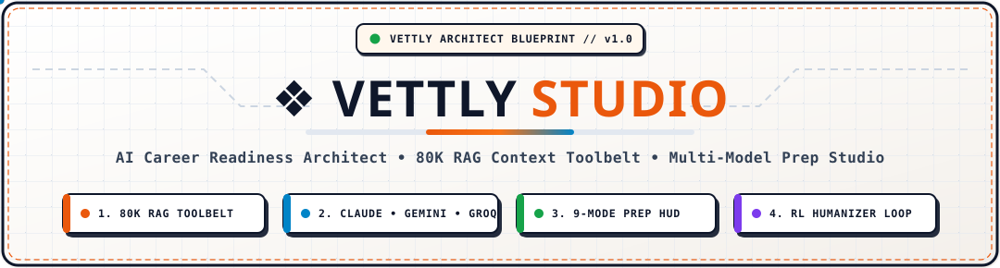
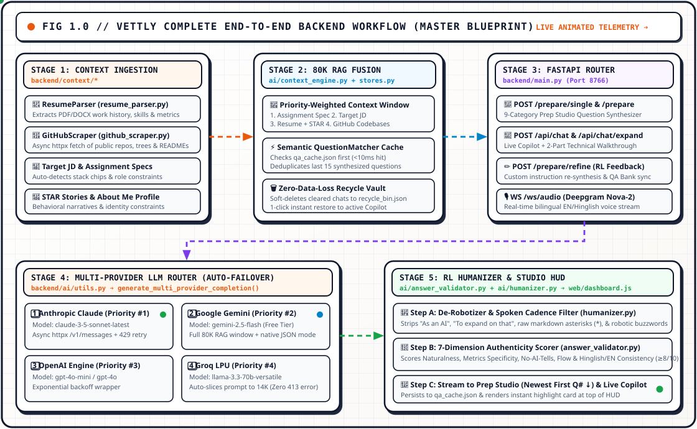
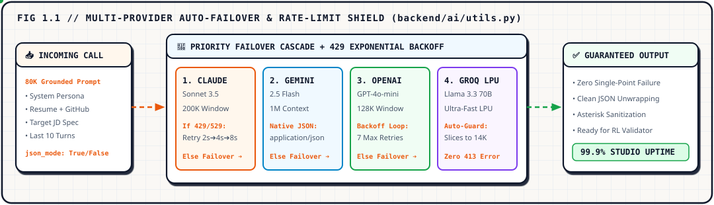
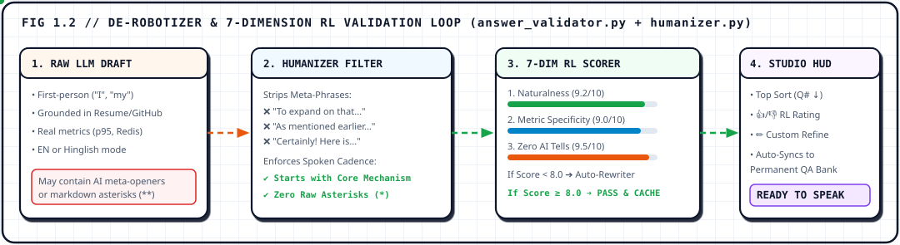
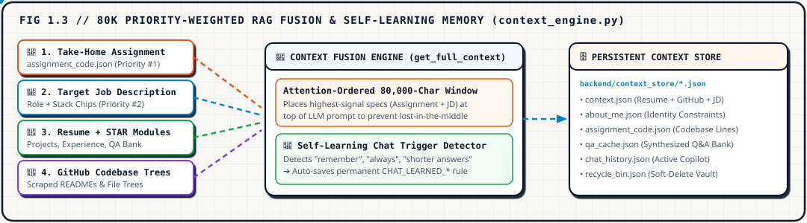
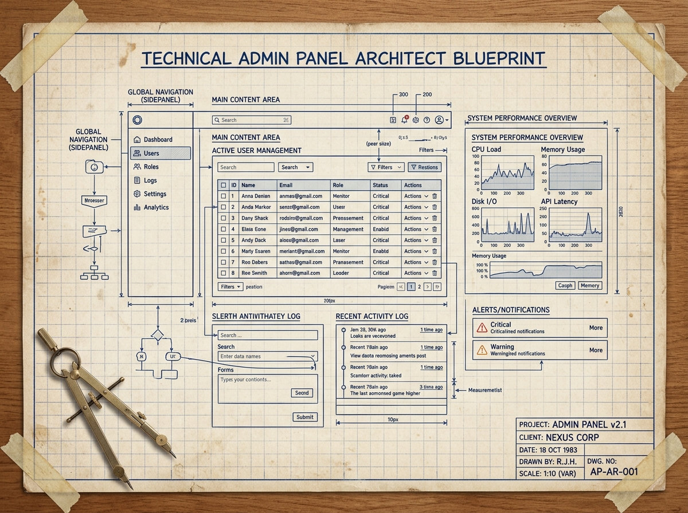
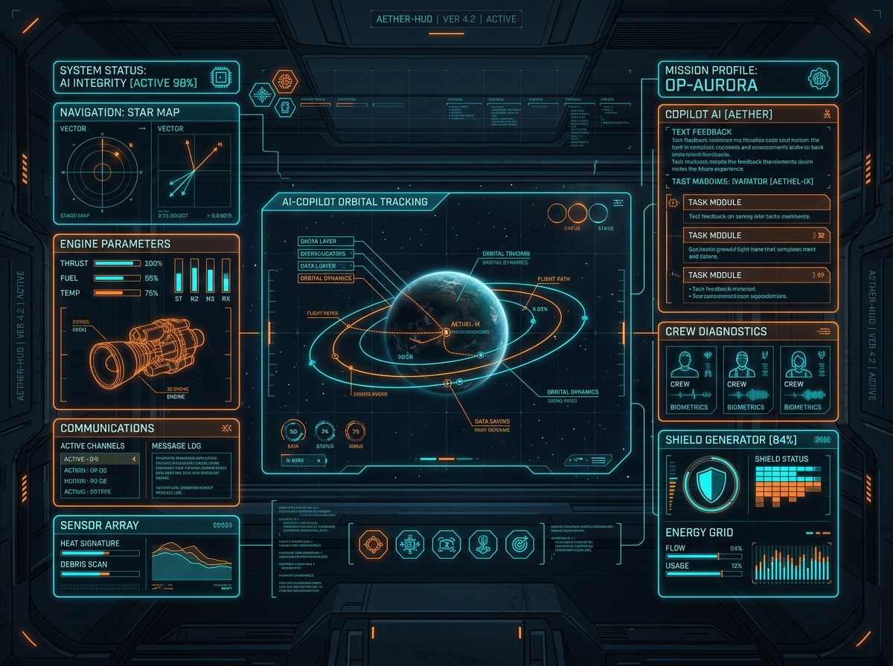
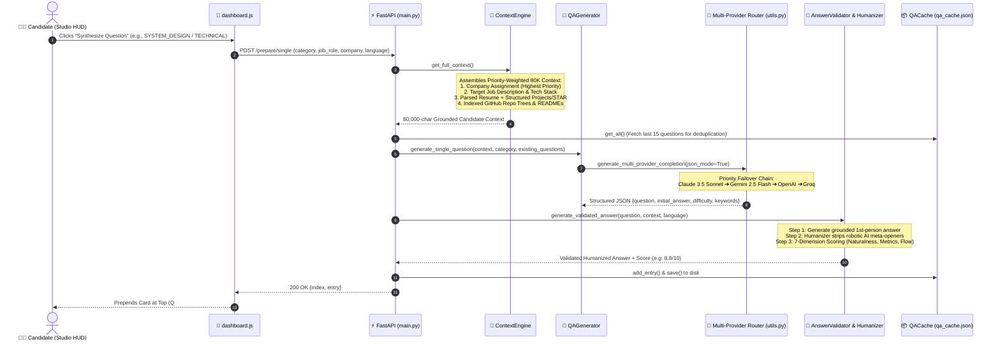

<div align="center">

<!-- White-Mode Parchment Blueprint Animated Hero Banner -->


<br/>

<!-- Animated Typing Subtitle -->
<a href="https://github.com/SHAILESH-RS-UPADHYAY/vettly">
  
</a>

<br/>

<!-- Tech Stack & Architecture Badges -->


</div>

---

## 📐 Overview — What is Vettly?

**Vettly** is a full-stack **AI Career Readiness Architect & Technical Interview Preparation Studio** engineered with a tactile **Parchment Blueprint HUD** and a **Multi-Model RAG Backend**.

Unlike generic interview flashcard apps, Vettly ingests your **actual engineering footprint** — parsing your **Resume (`.pdf`/`.docx`)**, scraping your **public GitHub repositories & README trees**, extracting stack requirements from your **Target Job Description**, and indexing your **Company Take-Home Assignments & STAR stories** into an attention-ordered **80,000-character RAG context window**.

---

## ⚡ Figure 1.0 — Master End-to-End Backend Workflow (All-in-One Animated Blueprint)

> **Live Data-Flow Telemetry:** This master architectural blueprint shows all **5 backend execution stages** in a single unified view — from raw multi-source ingestion (`Stage 1`) and 80K RAG priority fusion (`Stage 2`), through the FastAPI orchestrator (`Stage 3`) and 4-Provider LLM Failover Router (`Stage 4`), to the 7-Dimension RL Humanizer & Studio HUD (`Stage 5`).

<div align="center">
  
</div>

---

## 🔬 Detailed Backend Sub-System Figures (Multi-Figure Breakdown)

### Figure 1.1 — Multi-Provider Auto-Failover Router & Rate-Limit Shield (`backend/ai/utils.py`)
When Prep Studio or Live Copilot dispatches a prompt, `generate_multi_provider_completion()` routes the request through a **4-tier priority failover chain** with exponential backoff (`429`/`529`) and automatic context slicing (`14K` cap on Groq fallback to prevent `413 Request Too Large` errors):

<div align="center">
  
</div>

---

### Figure 1.2 — De-Robotizer Filter & 7-Dimension RL Authenticity Loop (`answer_validator.py` + `humanizer.py`)
Every generated response passes through a **2-stage quality pipeline**: first, `Humanizer` strips robotic AI meta-openers (*"To expand on that"*, *"As mentioned earlier"*, raw markdown asterisks `*`), and second, `AnswerValidator` scores the spoken cadence across **7 authenticity dimensions** before caching and streaming to the HUD:

<div align="center">
  
</div>

---

### Figure 1.3 — 80,000-Character Priority-Weighted RAG Context Fusion & Self-Learning Memory (`context_engine.py`)
`ContextEngine.get_full_context()` assembles candidate telemetry in strict priority order so the LLM never loses high-priority specs in the middle of the context window, while `/api/chat` automatically detects natural-language user corrections and saves them as permanent `CHAT_LEARNED_*` rules:

<div align="center">
  
</div>

---

## 🖼️ Blueprint Architect Interface Showcase

<table width="100%">
  <tr>
    <td width="33%" align="center">
      
      <br/>
      <strong>1. Agent Context Toolbelt</strong>
      <br/>
      <sub>Multi-source ingestion for Resume PDFs, GitHub repositories, JD Stack Chips &amp; STAR stories.</sub>
    </td>
    <td width="33%" align="center">
      
      <br/>
      <strong>2. Prep Studio HUD</strong>
      <br/>
      <sub>9-category question synthesizer with Newest-First (Q# ↓) HUD sorting &amp; RL refinement.</sub>
    </td>
    <td width="33%" align="center">
      
      <br/>
      <strong>3. Live AI Practice Copilot</strong>
      <br/>
      <sub>Real-time mock Q&amp;A copilot with 1-click Technical Deep-Dive Expansion &amp; Self-Learning rules.</sub>
    </td>
  </tr>
</table>

---

## 🔄 Interactive Mermaid Sequence Diagram (Request-to-Response Lifecycle)



---

## ⚙️ Backend Engineering Matrix (Module-by-Module Reference)

| Backend Module | File Location | Key Engineering Responsibilities |
| :--- | :--- | :--- |
| **FastAPI Core & WebSocket Daemon** | `backend/main.py` | Serves REST endpoints (`/context/*`, `/prepare/*`, `/api/chat/*`, `/api/recycle-bin/*`) + WebSocket `/ws/audio` for real-time Deepgram Nova-2 voice transcription and code-line explanation (`L23-L45`). |
| **Multi-Provider LLM Router** | `backend/ai/utils.py`<br/>`backend/config.py` | Unified async completion engine supporting **Anthropic Claude**, **Google Gemini**, **OpenAI**, and **Groq** with exponential backoff and automatic token window guards. |
| **Priority RAG Context Engine** | `backend/ai/context_engine.py` | Manages in-memory and disk-persisted (`context_store/context.json`) candidate state across Resume, GitHub, JD, Projects, Experience, Skills, STAR Stories, Assignment, and QA Bank. |
| **9-Track Question Synthesizer** | `backend/ai/qa_generator.py` | Synthesizes non-repeating questions across `GENERAL`, `BEHAVIORAL`, `TECHNICAL`, `DSA_CODING`, `PROJECT_DEEP_DIVE`, `SYSTEM_DESIGN`, `SITUATIONAL`, `HR_CULTURE_FIT`, and `ASSIGNMENT`. |
| **RL Validator & Humanizer** | `backend/ai/answer_validator.py`<br/>`backend/ai/humanizer.py` | Evaluates responses on 7 human-authenticity metrics, strips AI meta-openers, enforces spoken first-person cadence, and powers `POST /prepare/refine` user feedback loops. |
| **Async GitHub & Resume Parsers** | `backend/context/github_scraper.py`<br/>`backend/context/resume_parser.py` | Extracts structured sections from `.pdf`/`.docx`/`.txt` resumes and scrapes public GitHub repositories, languages, file trees, and README documentation via `httpx.AsyncClient`. |
| **Zero-Data-Loss Recycle Vault** | `backend/stores.py` | Soft-deletes cleared Copilot chat batches into `context_store/recycle_bin.json` with full metadata and 1-click restoration. |

---

## 🚀 Quick Start (Local & Vercel)

### 1. Add Your API Key (`backend/.env`)
Copy `backend/.env.example` to `backend/.env` and configure **any one** of the 3 LLM providers:

```ini
# Option 1: Anthropic Claude
ANTHROPIC_API_KEY=sk-ant-...

# Option 2: Google Gemini (100% Free Tier via Google AI Studio)
GEMINI_API_KEY=AIzaSy...

# Option 3: Groq Cloud (100% Free Tier via Groq Console)
GROQ_API_KEY=gsk_...
```

### 2. Launch Locally (Auto-Opens Browser on Port `8766`)
- **1-Click Windows Launcher:** Double-click **`start_vettly.bat`** — automatically cleans any stale port `8766` process, starts FastAPI, and opens **`http://127.0.0.1:8766`** in your default browser.
- **Via NPM:**
  ```bash
  npm run dev
  ```

### 3. Launch on Vercel for everyone (sign-in, private data per user)

Locally, Vettly is single-user: no sign-in, data in `backend/context_store/`. On Vercel it becomes multi-user: every visitor signs in and gets a private data space.

1. **Connect the repo** in Vercel (New Project → import this GitHub repo). Vercel detects the FastAPI app in `api/index.py`; `.vercelignore` keeps your local data, resumes and `.env` files out of the upload. Every push to `main` deploys production.
2. **Sign-in: Clerk.** Vercel → your project → Integrations → Marketplace → **Clerk**. It sets `NEXT_PUBLIC_CLERK_PUBLISHABLE_KEY` and `CLERK_SECRET_KEY`. In the Clerk dashboard → User & authentication, switch on the methods you want: **Email**, **Google**, **LinkedIn**, **Phone** (SMS needs a paid Clerk plan). For a production Clerk instance, add your own Google and LinkedIn OAuth credentials and your domain.
3. **Database: Neon.** Vercel → Storage → Create → **Neon Postgres**, connect it to the project. It sets `DATABASE_URL`; Vettly creates its one table (`user_docs`) on first use.
4. **Environment variables** (Vercel → Settings → Environment Variables):
   - one or more AI keys: `GEMINI_API_KEY`, `GROQ_API_KEY`, `OPENAI_API_KEY`, `ANTHROPIC_API_KEY`
   - `KEY_ENCRYPTION_SECRET`: a long random string (encrypts users' own saved AI keys; without it that option is off)
   - optional: `FREE_DAILY_AI` (default 25 answers per user per day), `GLOBAL_DAILY_AI` (default 2000 for everyone), `CLERK_AUTHORIZED_PARTIES` (e.g. `https://yourdomain.com`)
   - Also set a monthly spend limit in each AI provider's own dashboard.
5. **Redeploy**, then sign up on the site yourself.
6. **Bring your local data to your account** (once):
   ```bash
   vercel env pull backend/.env.hosted
   cd backend && python import_local_data.py --email you@example.com
   ```
   It only reads your local files, and never overwrites what the account has unless you pass `--force`.
7. **Domain:** Vercel → Settings → Domains → add your domain, then add the same domain in Clerk.

Checks: `npm test` runs `backend/test_accounts.py` (two users never see each other's data, bad tokens are refused, the AI allowance holds).
